# Praxis — System Architecture

> **Canonical System Architecture Specification**  
> Reference documentation lives in [`docs/`](docs/): the [API Specification](docs/api.md), [Data Model](docs/data-model.md), [Agent Runtime Details](docs/agent-runtime.md), [Security Policy & Threat Model](docs/security.md), [User Interface Architecture](docs/ui.md), [Deployment Guide](docs/deployment.md), [Development Workflow](docs/development.md), [Environment Reference](docs/environment.md), and [Release Procedure](docs/release-procedure.md).

Praxis is an open-source, local-first control plane and supervisory environment designed for running, observing, and coordinating autonomous coding agents. It hosts multiple agent CLIs in parallel, captures their stdout streams, classifies progress and risks through an AWS Strands-powered supervisory layer, and halts destructive commands using enforceable **human-in-the-loop approval gates**.

Praxis is a **supervision and orchestration layer, not an operating-system sandbox**: the human retains authoritative judgment, and the system ensures that critical operational decisions reach the human before commands touch the filesystem.

---

## Table of Contents

- [1. Core Paradigm & Product Philosophy](#1-core-paradigm--product-philosophy)
  - [1.1 Agents Scale; Human Attention Does Not](#11-agents-scale-human-attention-does-not)
  - [1.2 Enforceable Gates vs. Ignorable Notifications](#12-enforceable-gates-vs-ignorable-notifications)
  - [1.3 The Supervisor Proposes; The Human Disposes](#13-the-supervisor-proposes-the-human-disposes)
  - [1.4 Process Independence (Zero UI Coupling)](#14-process-independence-zero-ui-coupling)
  - [1.5 Local-First & 100% Offline Capability](#15-local-first--100-offline-capability)
- [2. System Architecture Topology](#2-system-architecture-topology)
  - [2.1 Process Separation Invariant](#21-process-separation-invariant)
  - [2.2 High-Level Architecture Diagram](#22-high-level-architecture-diagram)
- [3. Component Deep Dives](#3-component-deep-dives)
  - [3.1 Web & API Gateway (`src/server.ts`)](#31-web--api-gateway-srcserverts)
  - [3.2 Persistent Background Daemon (`src/daemon/daemon.ts`)](#32-persistent-background-daemon-srcdaemondaemonts)
  - [3.3 Runtime Registry & Adapters (`src/cli-registry.ts`)](#33-runtime-registry--adapters-srccli-registryts)
  - [3.4 PTY Manager & Session Multiplexing (`src/pty-manager.ts`)](#34-pty-manager--session-multiplexing-srcpty-managerts)
  - [3.5 Supervisor & Activity Classification (`src/strands/`)](#35-supervisor--activity-classification-srcstrands)
  - [3.6 Safety Gates & Centralized Resolution (`src/gate-resolve.ts`)](#36-safety-gates--centralized-resolution-srcgate-resolvets)
  - [3.7 Model Context Protocol (MCP) Inter-Agent Bus (`src/mcp-server.ts`)](#37-model-context-protocol-mcp-inter-agent-bus-srcmcp-serverts)
  - [3.8 LocalHarness & Offline ACP Execution (`src/daemon/localharness-agents.ts`)](#38-localharness--offline-acp-execution-srcdaemonlocalharness-agentsts)
  - [3.9 Shared Memory, Wiki, and Skills Discovery (`src/storage.ts`)](#39-shared-memory-wiki-and-skills-discovery-srcstoragets)
  - [3.10 Electron Desktop Shell (`electron/main.ts`)](#310-electron-desktop-shell-electronmaints)
- [4. Execution-Flow Diagrams](#4-execution-flow-diagrams)
  - [4.1 Starting an Agent (Preflight & Initialization)](#41-starting-an-agent-preflight--initialization)
  - [4.2 The Dual-Layer Safety Loop](#42-the-dual-layer-safety-loop)
  - [4.3 Resolving an Approval Gate](#43-resolving-an-approval-gate)
  - [4.4 Approving a Supervisor Proposal Plan](#44-approving-a-supervisor-proposal-plan)
  - [4.5 LocalHarness Turn Lifecycle over ACP](#45-localharness-turn-lifecycle-over-acp)
  - [4.6 Desktop Application Lifecycle](#46-desktop-application-lifecycle)
- [5. State, Persistence & Lifecycle](#5-state-persistence--lifecycle)
  - [5.1 Storage Layout & File Ownership](#51-storage-layout--file-ownership)
  - [5.2 Atomic Write Locking (`fs.openSync wx`)](#52-atomic-write-locking-fsopensync-wx)
  - [5.3 Agent Lifecycle State Machine](#53-agent-lifecycle-state-machine)
- [6. Security Boundaries & Threat Model](#6-security-boundaries--threat-model)
  - [6.1 What Is Protected](#61-what-is-protected)
  - [6.2 Asymmetric Voice Approval Architecture](#62-asymmetric-voice-approval-architecture)
  - [6.3 Unauthenticated Local Loopback Boundaries](#63-unauthenticated-local-loopback-boundaries)
  - [6.4 Pattern-Matching Limitations vs. OS Sandboxes](#64-pattern-matching-limitations-vs-os-sandboxes)
- [7. Verification Matrix & Evidence](#7-verification-matrix--evidence)
- [8. Implementation Source Map](#8-implementation-source-map)

---

## 1. Core Paradigm & Product Philosophy

Praxis’s architecture is structured around five operational principles derived from empirical testing of autonomous multi-agent software engineering.

### 1.1 Agents Scale; Human Attention Does Not
Starting ten agent CLIs simultaneously is computationally trivial. Monitoring ten independent, fast-scrolling terminal logs simultaneously is cognitively impossible. When agents run without centralized supervision, critical questions, unexpected failures, and destructive operations drown in terminal noise. Praxis continuously monitors stdout streams, filters noise, synthesizes milestones into a single collaborative timeline (Group Chat), and surfaces only events that require human intervention.

### 1.2 Enforceable Gates vs. Ignorable Notifications
A security or operational boundary cannot rely on a non-blocking notification. When an agent attempts a high-risk operation (`rm -rf`, `git push --force`, `DROP TABLE`, or an interactive confirmation prompt), Praxis freezes the agent's turn where it stands. The terminal is brought forward in an **Approval Gate Modal**, blocking execution until a human explicitly authorizes (`y`), rejects (`n`), or redirects the turn.

### 1.3 The Supervisor Proposes; The Human Disposes
The AWS Strands Supervisory Engine possesses **zero autonomous write authority** to execute shell commands or modify user repositories directly. Its only mutating tool creates a structured *Proposal Plan*. A proposal cannot dispatch instructions to an agent without a human reviewing the exact prompt text and approving it.

### 1.4 Process Independence (Zero UI Coupling)
Agent tasks (compilations, long-running test suites, multi-file refactors) must never terminate because a user refreshed their browser, navigated to another page, closed a laptop lid, or restarted the web API server. Praxis decouples process ownership: the background daemon (`:3210`) owns all child PTYs and ACP streams, while the web gateway (`:3200`) and React frontend act as ephemeral, stateless observation clients.

### 1.5 Local-First & 100% Offline Capability
Praxis operates entirely on local hardware with zero external cloud dependencies required for baseline operation. While optional cloud frontier integrations (AWS Praxis, Anthropic Claude, OpenAI Codex) are supported, local models running via Ollama, LM Studio, or vLLM execute offline over the Agent Client Protocol (ACP) through LocalHarness with complete data privacy.

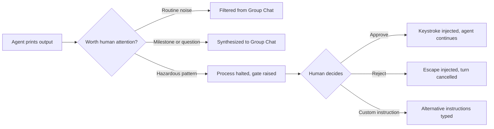

---

## 2. System Architecture Topology

### 2.1 Process Separation Invariant
Praxis enforces a strict two-process architecture on loopback:
1. **Web & API Gateway (`:3200`)**: Stateless Express 4.21 server delivering static Vite bundles, REST endpoints, and WebSocket event broadcasts. It owns **zero agent processes**.
2. **Persistent Daemon (`:3210`)**: Detached Node.js process managing pseudo-terminals (`node-pty`), ACP child processes, regex safety filtering, and state coordination.

### 2.2 High-Level Architecture Diagram

<div align="center">

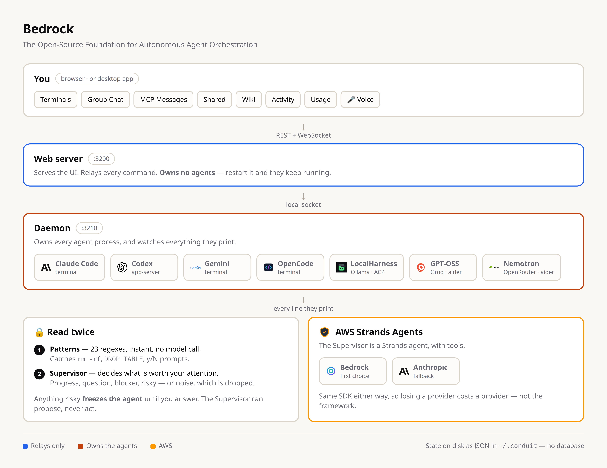

<p><em>The canonical one-page visual system architecture sheet rendered from <code>scripts/architecture.html</code> via <code>npm run architecture</code>.</em></p>

</div>

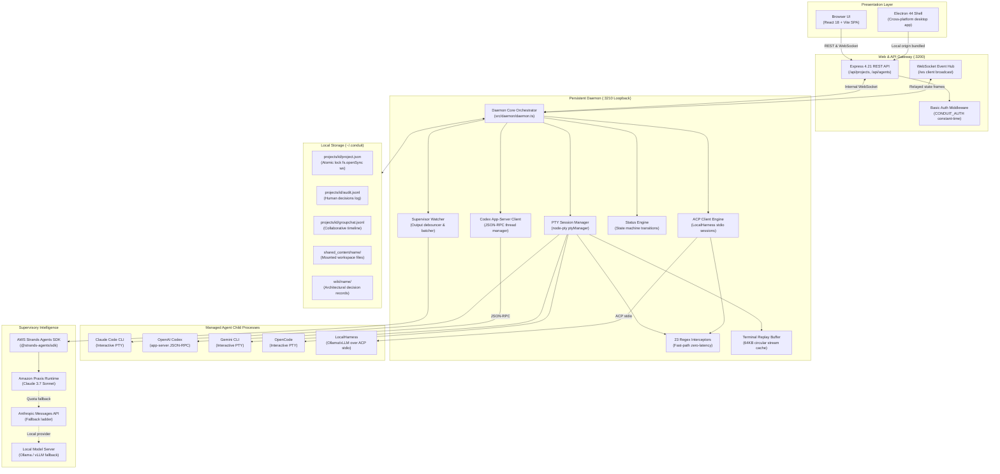

---

## 3. Component Deep Dives

### 3.1 Web & API Gateway (`src/server.ts`)
- **Entry Point**: `src/server.ts` initialized via `src/server-app.ts`.
- **Responsibilities**:
  - Delivers compiled static assets (`dist/client/`) built by Vite.
  - Exposes REST routing defined in `src/routes.ts` (`/api/projects`, `/api/agents`, `/api/health`).
  - Terminates browser WebSocket connections at `/ws` and routes audio streams at `/ws/voice`.
  - Enforces HTTP Basic Authentication (`CONDUIT_AUTH`) across HTTP endpoints and WebSocket upgrade handshakes using timing-safe buffer comparison (`src/auth.ts`).
- **State Invariant**: The web server holds **zero durable state**. It acts strictly as an API proxy and state reflector for the daemon.

### 3.2 Persistent Background Daemon (`src/daemon/daemon.ts`)
- **Entry Point**: `src/daemon/daemon.ts` listening on loopback port `3210`.
- **Responsibilities**:
  - Serves as the authoritative master of all agent child processes.
  - Houses the **Status Engine** (`src/daemon/status-engine.ts`), which is the sole writer of an agent's lifecycle state (`stopped`, `running`, `awaiting_input`, `idle`).
  - Manages internal WebSocket dispatch protocol (`src/daemon/protocol.ts`) connecting the web gateway to child sessions.
  - Hosts `/org/*` loopback management endpoints utilized by the Keeper and CLI tooling.

### 3.3 Runtime Registry & Adapters (`src/cli-registry.ts`)
`src/cli-registry.ts` is the single source of truth for runtime definitions, executable names, installation checks, and environment configurations:

| Runtime ID | Executable | Mode | Status Detection | Protocol / Interface |
| :--- | :--- | :--- | :--- | :--- |
| `claude` | `claude` | Interactive PTY | Hook events + Output regex | PTY stdin/stdout + lifecycle HTTP hooks |
| `codex` | `codex` | Structured RPC | `session/update` items | JSON-RPC over `codex app-server` |
| `gemini` | `gemini` | Interactive PTY | Process liveness | PTY stdin/stdout |
| `opencode` | `opencode` | Interactive PTY | Process liveness | PTY stdin/stdout |
| `gpt` | `aider` | Interactive PTY | Process liveness | PTY with `--model groq/llama-3.3-70b-versatile` |
| `nemotron` | `aider` | Interactive PTY | Process liveness | PTY with `--model openrouter/nvidia/llama-3.1-nemotron-70b-instruct` |
| `localharness` | `localharness`| ACP Session | ACP Turn Lifecycle | Agent Client Protocol (ACP) over stdio |

### 3.4 PTY Manager & Session Multiplexing (`src/pty-manager.ts`)
- Spawns operating system pseudo-terminals using `node-pty`.
- **Ring Buffer Caching**: Maintains an in-memory 64KB circular buffer of terminal output. When a user connects to a running agent, the buffered history is immediately replayed to populate `xterm.js`.
- **Preflight Validation**: Before spawning an agent, validates whether the binary exists on system `PATH` and verifies required environment variables. If missing, returns an actionable error message specifying the exact installation command.
- **Process Group Termination**: Calls `tree-kill` on agent termination to ensure child compilers, debuggers, and spawned test processes are completely cleaned up.

### 3.5 Supervisor & Activity Classification (`src/strands/`)
The supervisor watches raw agent outputs, extracts key milestones, and formulates strategic proposals:
- **Framework**: Implemented as an AWS Strands Agent (`@strands-agents/sdk`) in `src/strands/agent.ts`.
- **Batching & Throttling**: `src/strands/watcher.ts` debounces terminal stdout in 10-second batches and throttles model classifications to at most once per agent per 20 seconds.
- **Provider Fallback Ladder** (`src/strands/anthropic.ts` & `src/strands/failure.ts`):
  1. Primary: Amazon Praxis (`PraxisModel` using `us.anthropic.claude-sonnet-4-5-20250929-v1:0`).
  2. Fallback: Anthropic direct API (`AnthropicModel` via `ANTHROPIC_API_KEY`).
  3. Quota Recovery: Automatically steps down from Sonnet to Haiku upon encountering AWS token limits (HTTP 429).
  4. Local Fallback: Local model server via `SUPERVISOR_PROVIDER=local` or `ollama`.

### 3.6 Safety Gates & Centralized Resolution (`src/gate-resolve.ts`)
- **Single Source of Truth**: All approval gate resolutions (from the Web UI, voice commands, or automated tools) execute through `resolveGate()` in `src/gate-resolve.ts`.
- **Deterministic Interception**: ANSI escape sequences are stripped via `stripAnsi()`, and text is evaluated against 23 regular expressions (`src/gatePatterns.ts`).
- **Settle Window**: Confirmation prompts (`[y/N]`) wait for a 400ms terminal silence window before evaluating, preventing fast-scrolling build logs from triggering false gates.
- **Audit Logging**: Every decision (approved, rejected, or redirected) is appended atomically to `audit.jsonl` with authorising metadata and timestamp.

### 3.7 Model Context Protocol (MCP) Inter-Agent Bus (`src/mcp-server.ts`)
- Implements `@modelcontextprotocol/sdk` to provide structured inter-agent communication.
- Spawned as a child stdio process per agent session with project and agent identity arguments (`--project`, `--agent`, `--name`).
- Exposes two tools:
  - `list_teammates`: Returns active peer agents in the project (name, role, status).
  - `message_agent`: Delivers a structured message directly into a peer agent’s session.
- **Bounded Request Timeout**: Employs a 10-second `AbortSignal.timeout(10000)` on all HTTP calls to prevent agent turns from hanging indefinitely during gateway restarts.

### 3.8 LocalHarness & Offline ACP Execution (`src/daemon/localharness-agents.ts`)
- Runs local open-weights models (Qwen 2.5 Coder, DeepSeek-Coder, Llama 3.3) 100% offline via Ollama, LM Studio, or vLLM.
- Communicates over stdio via the **Agent Client Protocol (ACP)** (`src/daemon/acp-client.ts`).
- **Permission Mapping**: LocalHarness runs in `guarded` mode by default. File edits and shell commands surface as structured ACP approval gates (`allow_once`, `reject_once`).
- **Prompt Queuing**: Because ACP processes one turn sequentially, incoming peer messages and user instructions are queued to prevent turn interleaving or dropped inputs.

### 3.9 Shared Memory, Wiki, and Skills Discovery (`src/storage.ts`)
- **Workspace Containment**: All filesystem paths are asserted against project directory boundaries using `storage.resolveInside()`, mitigating path traversal attacks (`../`).
- **Skills System** (`src/skills.ts`): Automatically discovers workflow guides from `.praxis/skills/*/SKILL.md` and exposes them in the Team view and system prompts.
- **Project Wiki**: Stores versioned markdown architectural documentation in `~/.conduit/wiki/<project_name>/`.
- **Shared Artifacts**: Mounted directory `~/.conduit/shared_content/<project_name>/` enabling peer agents to exchange specifications and code files.

### 3.10 Electron Desktop Shell (`electron/main.ts`)
- **Architecture**: Wraps the Praxis stack into native desktop packages for Linux, macOS, and Windows.
- **Daemon Lifecycle Manager** (`electron/daemon-manager.ts`): Electron spawns and monitors both the daemon (`:3210`) and web server (`:3200`) as background child processes, terminating them cleanly upon application exit.
- **Environment Sanitization**: Strips `ELECTRON_RUN_AS_NODE` on startup to prevent Electron from silently launching in headless CLI mode when invoked from VSCode or other Electron terminals.
- **Window State Preservation** (`electron/window-state.ts`): Restores window coordinates, dimensions, and display assignments while validating geometry against active monitor boundaries.

---

## 4. Execution-Flow Diagrams

### 4.1 Starting an Agent (Preflight & Initialization)

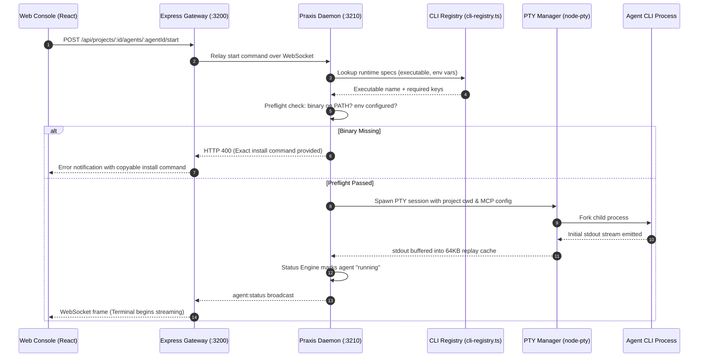

### 4.2 The Dual-Layer Safety Loop

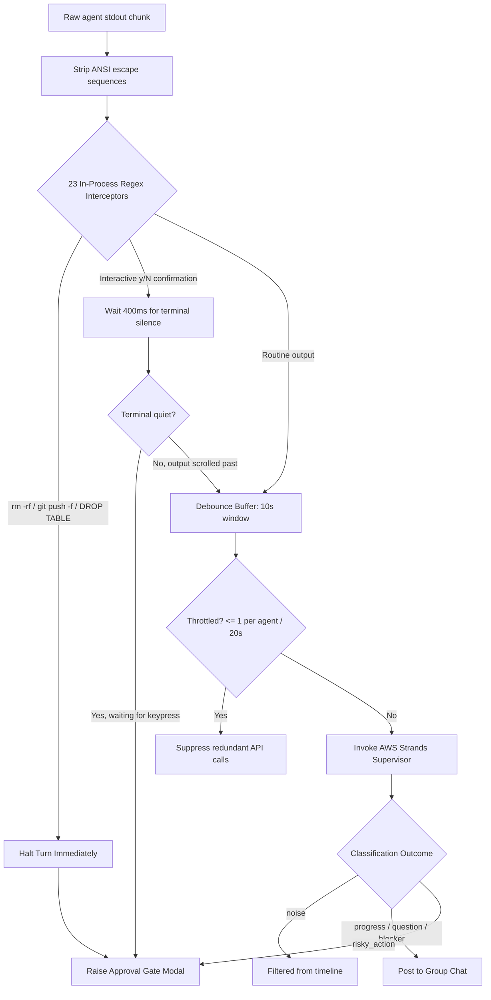

### 4.3 Resolving an Approval Gate

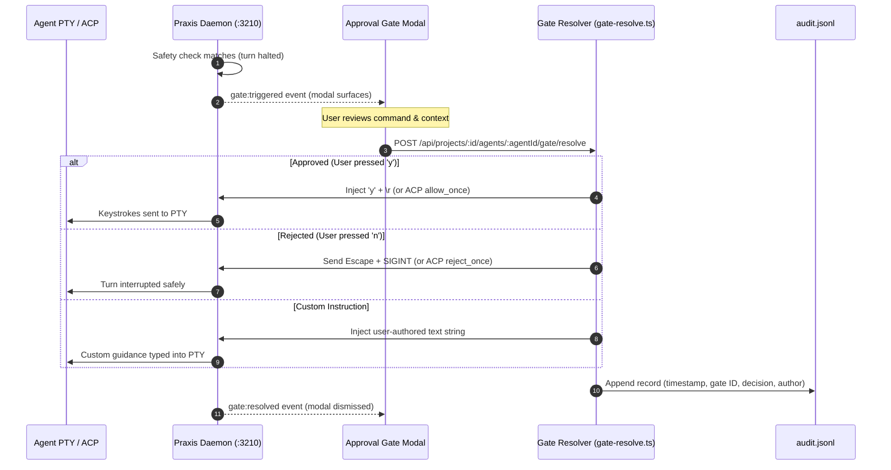

### 4.4 Approving a Supervisor Proposal Plan

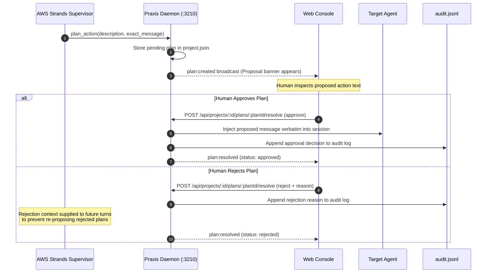

### 4.5 LocalHarness Turn Lifecycle over ACP

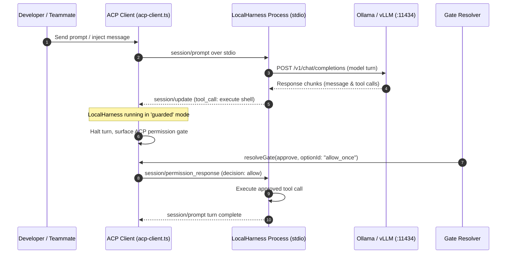

### 4.6 Desktop Application Lifecycle

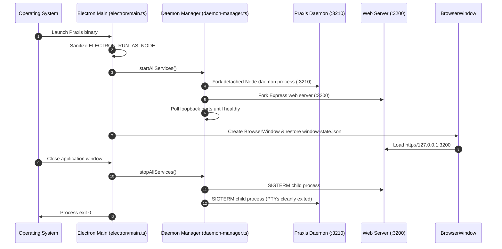

---

## 5. State, Persistence & Lifecycle

### 5.1 Storage Layout & File Ownership
Praxis relies entirely on plain JSON and JSONL flat files stored in `~/.conduit`. There is no SQL database, external key-value store, or cloud-hosted state:

```
~/.conduit/
├── .env                       # Machine-level environment overrides
├── api-keys.json              # Local API keys (restricted 0600 permissions)
├── supervisor-log.jsonl       # Audit trail of all supervisor classifications
├── brain-private/             # The Keeper private working memory
├── projects/
│   └── <project-uuid>/
│       ├── project.json       # Project configuration, agent configs, pending plans
│       ├── groupchat.jsonl    # Timeline of messages, milestones, and supervisor notes
│       └── audit.jsonl        # Immutable ledger of all human gate decisions
├── shared_content/
│   └── <safe-project-name>/   # Files shared across agents in this project
└── wiki/
    └── <safe-project-name>/   # Durable markdown documentation and memory
```

### 5.2 Atomic Write Locking (`fs.openSync wx`)
Because both the Express API gateway and the background daemon read and modify `project.json`, concurrent writes risk data corruption. Praxis implements atomic read-modify-write locking in `src/storage-fs.ts`:
- A lock is acquired by calling `fs.openSync(lockFile, 'wx')` (atomic creation flag; fails if the file exists).
- Writes use temporary files followed by atomic filesystem renames (`fs.renameSync`).
- Tested across 300 rapid concurrent writes across two processes: **0 lost updates, 100% valid JSON on every read**.

### 5.3 Agent Lifecycle State Machine

An agent's status is managed exclusively by the daemon's Status Engine (`src/daemon/status-engine.ts`):

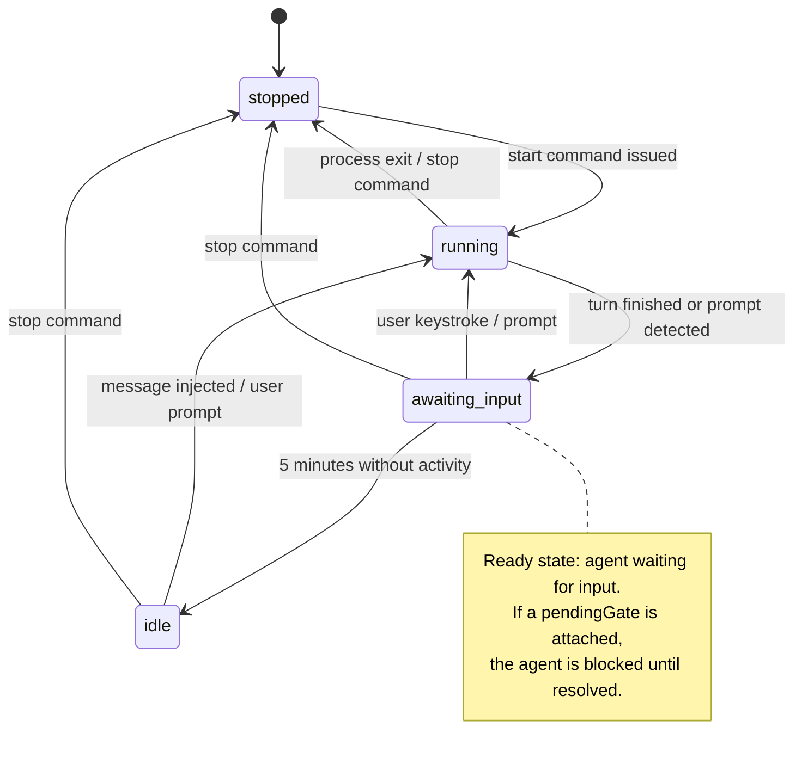

---

## 6. Security Boundaries & Threat Model

### 6.1 What Is Protected
- **Web UI & WebSocket Authentication**: When `CONDUIT_AUTH=user:pass` is set, both HTTP endpoints and WebSocket upgrade connections enforce constant-time basic credential verification.
- **Filesystem Containment**: All file operations resolve via `storage.resolveInside()`, preventing directory traversal beyond project boundaries.
- **XSS Sanitization**: Terminal output is rendered via `xterm.js`, and all agent-authored markdown is sanitized with `DOMPurify` before DOM rendering.
- **Local Secret Isolation**: Configured API credentials are saved in `~/.conduit/api-keys.json` with strict POSIX `0600` file permissions and are never broadcast over client WebSockets.

### 6.2 Asymmetric Voice Approval Architecture
When using bidirectional voice control (Amazon Nova Sonic):
- **Approval Rejection**: Spoken phrases such as *"reject"*, *"deny"*, or *"stop"* immediately interrupt the gate without qualification.
- **Approval Safeguards**: Spoken approval is asymmetric:
  1. Casual affirmations (*"yes"*, *"okay"*, *"go ahead"*) are **explicitly rejected** by type definition in `src/voice/approval-guard.ts`.
  2. Spoken approval requires that the gate was audibly read out, fewer than 60 seconds elapsed, and the user spoke the explicit phrase *"approve it"*.

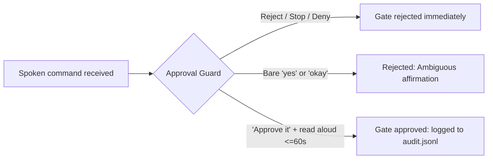

### 6.3 Unauthenticated Local Loopback Boundaries
> [!WARNING]
> The daemon's `/org/*` endpoints are unauthenticated on `127.0.0.1`.
> Any local process running on the host machine — including coding agents executed by Praxis — has network access to query project lists and inject instructions via localhost. Praxis is designed as a **single-user developer tool**. On shared multi-user workstations, run Praxis inside a container or virtual machine.

### 6.4 Pattern-Matching Limitations vs. OS Sandboxes
> [!IMPORTANT]
> **Praxis's approval gates are pattern-based policy interceptors, NOT an operating-system sandbox.**
> - Detection evaluates 23 regex patterns on terminal text streams. Obfuscated commands (e.g. `python3 -c "import shutil; shutil.rmtree('/')"` or encoded base64 invocations) will not match standard regex patterns.
> - Praxis does not enforce Linux namespaces, seccomp filters, or chroot jails by default.
> - When executing untrusted agents or autonomous web-scraping CLIs, Praxis should be run inside a Docker container or ephemeral VM.

---

## 7. Verification Matrix & Evidence

Every architectural capability described in this specification is verified through automated test suites in continuous integration.

| Architectural Subsystem | Verification Suite / Script | Verification Scope | Current Result |
| :--- | :--- | :--- | :--- |
| **All Test Suites** | `npm test` | All 50 test suites via Node 22 native type-stripping | **50/50 passed (0 failed)** |
| **Gate Pattern Interceptors** | `test-regex-interceptor` | 23 regex patterns, ANSI stripping, interactive prompts | Verified passing |
| **Centralized Gate Resolution**| `test-approval-gates` | Keystroke injection, rejection interrupts, custom text | Verified passing |
| **Supervisor Concurrency & Fallback**| `test-supervisor-fallback` | 30 tests: AWS quota fallback, token exhaustion, local model | 30/30 passed |
| **LocalHarness ACP Integration**| `test-local-harness` | 8 tests: ACP stdio session, guarded permission gates | 8/8 passed |
| **MCP Server Lifecycle** | `test-mcp-lifecycle` | Tool registration, inter-agent messaging, timeout guards | Verified passing |
| **Storage Concurrency** | `test-storage-concurrency` | Atomic `fs.openSync wx` locking under 300 rapid writes | 0 lost updates |
| **Voice Approval Guard** | `test-voice-routing` | 59 tests: Asymmetric approval, wake phrase matching | 59/59 passed |
| **Electron Window State** | `test-window-state` | 8 tests: Multi-monitor geometry, display boundary bounds | 8/8 passed |
| **Mermaid Diagram Syntax** | `npm run check:mermaid` | Validates syntax of all architectural Mermaid diagrams | 15/15 valid |
| **Brand Assertion Lint** | `npm run check:brand` | Validates brand consistency and prevents naming regressions| Verified passing |
| **TypeScript Compilation** | `npm run typecheck` | Strict `tsc --noEmit` across backend and frontend | 0 errors |
| **Complete Quality Gate** | `npm run check:all` | Sequential verification: brand, lint, types, tests, build | **Clean exit (code 0)** |

---

## 8. Implementation Source Map

| Architectural Layer | Key Source Files | Relevant Documentation |
| :--- | :--- | :--- |
| **Web Gateway & API** | [`src/server.ts`](src/server.ts), [`src/server-app.ts`](src/server-app.ts), [`src/routes.ts`](src/routes.ts) | [docs/api.md](docs/api.md) |
| **Authentication & Security** | [`src/auth.ts`](src/auth.ts), [`src/storage-fs.ts`](src/storage-fs.ts) | [docs/security.md](docs/security.md) |
| **Daemon & Protocol** | [`src/daemon/daemon.ts`](src/daemon/daemon.ts), [`src/daemon/protocol.ts`](src/daemon/protocol.ts) | [docs/agent-runtime.md](docs/agent-runtime.md) |
| **Runtime Registry** | [`src/cli-registry.ts`](src/cli-registry.ts) | [docs/agent-runtime.md](docs/agent-runtime.md) |
| **PTY Management** | [`src/pty-manager.ts`](src/pty-manager.ts) | [docs/agent-runtime.md](docs/agent-runtime.md) |
| **Safety Interceptors** | [`src/gatePatterns.ts`](src/gatePatterns.ts), [`src/gate-policy.ts`](src/gate-policy.ts) | [docs/security.md](docs/security.md) |
| **Gate Resolution** | [`src/gate-resolve.ts`](src/gate-resolve.ts), [`src/gate-answer.ts`](src/gate-answer.ts) | [docs/security.md](docs/security.md) |
| **Supervisor Engine** | [`src/strands/watcher.ts`](src/strands/watcher.ts), [`src/strands/agent.ts`](src/strands/agent.ts) | [docs/agent-runtime.md](docs/agent-runtime.md) |
| **MCP Inter-Agent Bus** | [`src/mcp-server.ts`](src/mcp-server.ts), [`src/conduit-mcp-server.ts`](src/conduit-mcp-server.ts) | [docs/api.md](docs/api.md) |
| **LocalHarness & Models** | [`src/daemon/localharness-agents.ts`](src/daemon/localharness-agents.ts), [`src/local-llm.ts`](src/local-llm.ts) | [docs/environment.md](docs/environment.md) |
| **State & Persistence** | [`src/storage.ts`](src/storage.ts), [`src/storage-fs.ts`](src/storage-fs.ts) | [docs/data-model.md](docs/data-model.md) |
| **Desktop Shell** | [`electron/main.ts`](electron/main.ts), [`electron/daemon-manager.ts`](electron/daemon-manager.ts) | [docs/deployment.md](docs/deployment.md) |
