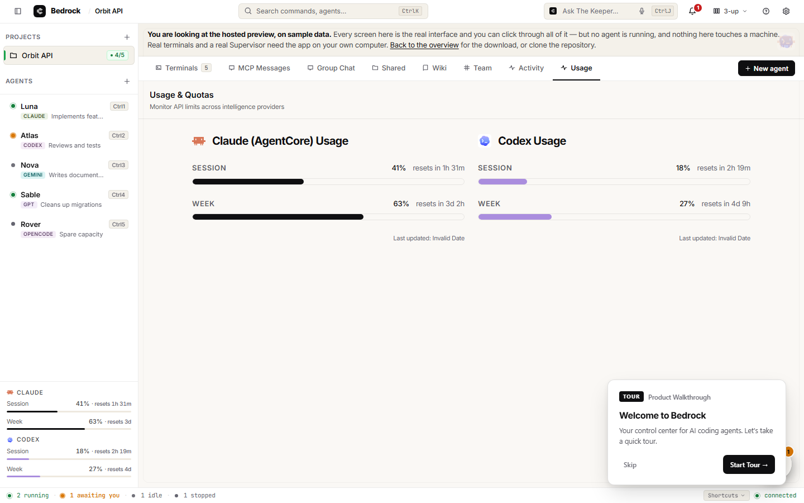
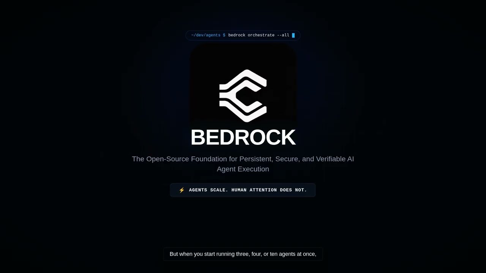
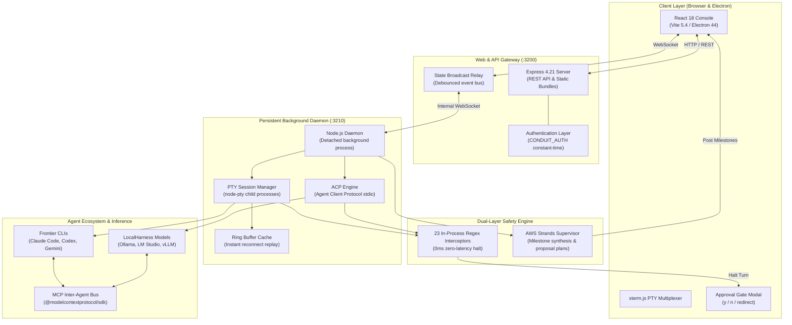

<div align="center">


# Praxis

### The Open-Source Foundation for Autonomous Agent Orchestration

**One persistent, local-first control plane for running, observing, and supervising coding agents — with real PTY sessions, dual safety interception, and human oversight.**

[](LICENSE)
[](https://github.com/puneetnith28/Praxis/actions/workflows/ci.yml)
[](https://github.com/puneetnith28/Praxis/actions/workflows/codeql.yml)
[](https://github.com/puneetnith28/Praxis/actions/workflows/dependency-review.yml)
[](https://github.com/puneetnith28/Praxis/actions/workflows/docs.yml)
[](https://nodejs.org/)
[](https://www.typescriptlang.org/)
[](https://github.com/puneetnith28/Praxis/releases)
[](CODE_OF_CONDUCT.md)

<p align="center">
  <a href="#at-a-glance">At a Glance</a> •
  <a href="#the-problem">The Problem</a> •
  <a href="#what-praxis-does">What Praxis Does</a> •
  <a href="#product-video">Product Video</a> •
  <a href="#quickstart">Quickstart</a> •
  <a href="#product-walkthrough">Product Walkthrough</a> •
  <a href="#architecture">Architecture</a> •
  <a href="#safety-and-human-oversight">Safety & Gates</a> •
  <a href="#supported-runtimes">Supported Runtimes</a> •
  <a href="#testing-and-quality-gates">Quality Gates</a> •
  <a href="#contributing">Contributing</a>
</p>

<p align="center">
  <a href="https://youtu.be/RW3yMBdo-eg"><strong>▶ Watch the Product Walkthrough on YouTube</strong></a>
</p>



</div>

---

## At a Glance

| Dimension | Specification | Details |
| :--- | :--- | :--- |
| **Product Purpose** | Autonomous Agent Control Plane | Supervise, multiplex, and orchestrate multiple coding agents locally with human approval gates. |
| **Primary Workflow** | Persistent PTY & ACP Multiplexing | Agents run in isolated background processes; terminal streams and JSON-RPC events surface in a unified console. |
| **Core Architecture** | Decoupled Client / Gateway / Daemon | React 18 UI ↔ Express API Gateway (`:3200`) ↔ Persistent Node.js Daemon (`:3210`) owning child processes. |
| **Supervision Model** | Dual-Layer Safety | Layer 1: In-process regex patterns catch catastrophic shell commands in 0ms. Layer 2: AWS Strands Supervisor extracts milestones. |
| **Human-in-the-Loop** | Enforceable Approval Gates | Sensitive shell commands (`git push -f`, recursive deletes, schema alterations) halt until human approves (`y`/`n`). |
| **Local-First Execution** | 100% Offline (LocalHarness) | Stream turns over Agent Client Protocol (ACP) with Ollama, LM Studio, or vLLM (`http://127.0.0.1:11434/v1`). |
| **Supported Runtimes** | Frontier & Open-Weights | Claude Code, OpenAI Codex, Google Gemini CLI, OpenCode, Aider/Groq, and LocalHarness models. |
| **Automated Verification** | 50 Passing Test Suites | 50/50 test suites verify lifecycle management, regex safety, supervisor fallback, state recovery, and PTY reconnection. |
| **Packaging Targets** | Cross-Platform Desktop | Electron 44 standalone bundles for Linux (`.AppImage`, `.deb`), macOS (`.dmg`, `.zip`), and Windows (`.exe`, `.zip`). |
| **License** | Open Source | [Apache License 2.0](LICENSE) |

---

## The Problem

Autonomous coding agents (Anthropic's **Claude Code**, OpenAI's **Codex**, Google's **Gemini CLI**, OpenCode, or local LLMs) are remarkably capable. However, running multiple agents in raw terminal windows creates four critical friction points:

1. **Attention Deficit Across Scattered Windows**: A developer running three or four CLI agents cannot monitor thousands of lines of streaming terminal output across independent windows. Key failures and questions get lost in terminal scrollback.
2. **Blind Trust in Hazardous Shell Commands**: Agents execute real bash commands. Without enforceable boundaries, an errant turn can trigger destructive operations (`rm -rf`, `git push --force origin main`, schema drops, overwriting environment files).
3. **Session Volatility & Process Abandonment**: Terminals tied to browser tabs or temporary shells terminate when a tab closes or a web server restarts, abandoning active compilations and tests mid-execution.
4. **Siloed Context & Uncoordinated Effort**: Coding agents operate in isolation. Agent A has no awareness of tests written by Agent B, architectural decisions documented by Agent C, or shared repository conventions.

**Praxis solves this.** It provides an ambient, local-first supervisory layer that keeps agent processes alive in a detached background daemon, multiplexes their terminals into a unified workspace, continuously distills raw output into clean milestones, and intercepts hazardous operations before they touch your codebase.

---

## What Praxis Does

```
+---------------------------------------------------------------------------------+
|                                 PRAXIS CONSOLE                                 |
|  [Terminals]  [MCP Messages]  [Group Chat]  [Shared]  [Wiki]  [Team]  [Activity]|
+---------------------------------------------------------------------------------+
|  Luna (Claude Code)           |  Atlas (OpenAI Codex)                           |
|  $ npm test                   |  $ git diff --stat                              |
|  ✓ 42 passed (2.8s)           |  4 files changed, 118 insertions(+)             |
|                               |                                                 |
+---------------------------------------------------------------------------------+
|  Group Chat (Ambient Stream)  |  Sable (Database Agent)                         |
|  [Supervisor] Luna: Tests pass|  $ git push --force origin main                 |
|  [Atlas] PR ready for review  |  >>> [APPROVAL GATE TRIGGERED] <<<              |
+---------------------------------------------------------------------------------+
```

### 1. Interactive Multi-Agent PTY Multiplexing
Praxis creates authentic operating system pseudo-terminals (`node-pty`). Click directly into any terminal, type commands, send `Ctrl+C`, or switch layouts (1-Up, 2-Up, 3-Up, Tmux Grid, or freeform Draggable Canvas).

### 2. Persistent Background Daemon (`:3210`)
Agent processes do not live in the browser or inside the web server. They run inside a detached Node.js background daemon on port `3210`. You can refresh the frontend, close the browser, or restart the Express web gateway on port `3200` without killing any running agents. Output is ring-buffered and seamlessly replays on reconnection.

### 3. Dual-Layer Safety Interception
- **Zero-Latency In-Process Interceptors**: 23 deterministic regex patterns continuously analyze PTY stdout and command executions. When a destructive pattern matches (such as hard resets, force pushes, or recursive directory deletions), the process halts instantly in `awaiting_input` state.
- **AWS Strands Supervisory Engine**: Periodically aggregates batched activity, synthesizes milestones into project chat, and raises context-aware gates.

### 4. Human-in-the-Loop Approval Gates
When an agent attempts a hazardous action or hits an interactive prompt, Praxis freezes the turn and surfaces an **Approval Gate Modal**:
- Press **`y`** to approve the command.
- Press **`n`** to reject and block the command.
- Type custom instructions to redirect the agent safely without manual terminal intervention.

### 5. 100% Offline Local Model Execution (LocalHarness)
Connect directly to local inference backends (Ollama, LM Studio, or vLLM) via OpenAI-compatible endpoints (`http://127.0.0.1:11434/v1`). Agents execute over the Agent Client Protocol (ACP), running completely offline with full privacy and no cloud API costs.

### 6. Inter-Agent Communication (MCP Bus)
Praxis includes bundled Model Context Protocol servers (`src/mcp-server.ts`). Companion agents discover teammates, query shared workspace context, and exchange direct messages across the MCP bus.

### 7. Shared Memory, Wiki, and Skills
- **Skills Discovery**: Workflows defined in `.praxis/skills/*/SKILL.md` are automatically parsed and made available to agents.
- **Project Wiki**: Durable, versioned markdown documentation stored in `.praxis/wiki/` provides persistent architectural memory across restarts.
- **Shared Directory**: Mounted workspace where companion agents collaborate on common schemas, specs, and release artifacts.

---

## Why Praxis is Different

| Feature | Raw Independent Terminals | Web-Based Cloud Terminals | Praxis Local Control Plane |
| :--- | :--- | :--- | :--- |
| **Session Lifetime** | Window-bound (exits on close) | Remote container / cloud instance | **Local background daemon (`:3210`)** |
| **Multi-Agent Oversight** | Scattered windows, manual alt-tab | Multi-tab cloud dashboard | **Unified multi-pane grid & canvas** |
| **Safety Interception** | None (direct unsanitized execution) | Cloud policy / container isolation | **Dual-layer: 23 regex + Strands supervisor** |
| **Approval Flow** | None or CLI prompt lost in scroll | Cloud modal | **Enforceable modal with `y`/`n`/redirect** |
| **Cross-Agent Awareness** | None (agents are unaware of peers) | Centralized cloud orchestrator | **Local MCP inter-agent messaging bus** |
| **Local Model Support** | Manual terminal scripting | Typically cloud-only | **Native LocalHarness (Ollama/vLLM over ACP)** |
| **Data Privacy** | Local, but uncoordinated | Transmitted to third-party cloud | **100% local-first; zero required cloud keys** |

---

## Product Video

Watch the complete demonstration film detailing Praxis's core architecture, multi-agent terminal orchestration, zero-latency safety interception, and persistent background daemon:

<div align="center">

[](https://youtu.be/RW3yMBdo-eg)

<p><em>Click the preview above to watch <strong><a href="https://youtu.be/RW3yMBdo-eg">Praxis: The Open-Source Control Plane for Coding Agents</a></strong> on YouTube (Video ID: <code>RW3yMBdo-eg</code>).</em></p>

</div>

---

## Quickstart

### Prerequisites
- **Node.js**: Version **22.6+** required (`node -v` >= 22.6 for native TypeScript type-stripping).
- **npm**: Version **10+** (bundled with Node.js 22).
- **Git**: Installed and available on system `PATH`.
- **Operating System**: Linux (Ubuntu 22.04+), macOS 13+, or Windows 11 (WSL2 recommended or native PowerShell).

### 1. Clone & Install
```bash
# Clone the repository
git clone https://github.com/puneetnith28/Praxis.git
cd Praxis

# Clean install dependencies (respects legacy-peer-deps configured in .npmrc)
npm ci
```

### 2. Configuration (Zero Keys Required for Local Use)
Praxis requires **zero environment variables or API keys** to launch and manage local CLI agents or local models.

To enable optional cloud features (AWS Praxis, Anthropic Claude supervisor, web authentication, or custom ports), copy `.env.example`:
```bash
cp .env.example .env
```

Key environment options in `.env`:
```ini
# Web API Gateway and Daemon Ports
PORT=3200
DAEMON_PORT=3210

# Optional: HTTP Basic Authentication for web UI (user:password)
CONDUIT_AUTH=admin:your-secure-password

# Optional: Supervisor Provider (auto | praxis | anthropic | local | off)
SUPERVISOR_PROVIDER=auto
AWS_REGION=us-east-1
PRAXIS_MODEL_ID=us.anthropic.claude-sonnet-4-5-20250929-v1:0

# Optional: Local Model Server (Ollama / LM Studio / vLLM)
LOCAL_LLM_BASE_URL=http://127.0.0.1:11434/v1
LOCAL_LLM_MODEL=qwen2.5-coder:latest
```

### 3. Launch Praxis

#### Development Mode (Concurrent with Hot Reload)
Runs `tsup` in watch mode, the background daemon, the web server, and the Vite dev server concurrently:
```bash
npm run dev
```
- **Vite Web Console**: [http://localhost:5173](http://localhost:5173)
- **Web API Server**: [http://localhost:3200](http://localhost:3200)
- **Praxis Daemon**: `ws://127.0.0.1:3210`

#### Production Mode
Compiles production bundles and launches both daemon and web servers:
```bash
npm run build
npm run start:all
```
Open [http://localhost:3200](http://localhost:3200) in your browser.

#### Seeding Sample Demo Data
To explore Praxis immediately with pre-configured multi-agent projects:
```bash
npm run seed:demo
```

---

## Product Walkthrough

### 1. Create a Project
1. Open the Praxis console at [http://localhost:5173](http://localhost:5173) (or `http://localhost:3200` in production).
2. Click **+ New Project** in the left sidebar.
3. Enter a project name and designate a working repository directory.

### 2. Spawn Agents
1. Click **+ Add Agent** in the project header.
2. Select your agent runtime:
   - **Claude Code**: Anthropic CLI with lifecycle hooks.
   - **Codex CLI**: OpenAI app-server JSON-RPC items.
   - **Gemini CLI**: Google CLI agent via interactive PTY.
   - **LocalHarness**: 100% offline local model (Ollama / vLLM).
3. Click **Start Agent**. The daemon launches a child process and attaches an interactive PTY.

### 3. Observe & Supervise
1. Navigate to the **Terminals** tab to watch stdout in real time. Switch layouts (1-Up, 2-Up, or Tmux grid) using the header switcher.
2. Check the **Group Chat** tab where the supervisor summarizes raw terminal streams into high-level milestones.
3. If an agent issues a hazardous command (e.g. `git push --force`), the **Approval Gate Modal** appears. Press **`y`** to approve, **`n`** to reject, or type an alternative instruction.

---

## Visual Product Tour

The Praxis console provides eight dedicated views accessible from the top navigation bar:

| View Tab | Key Functionality | Primary Use Case |
| :--- | :--- | :--- |
| **Terminals** | Interactive xterm.js multiplexer, layout switcher, PTY replay buffer | Direct terminal typing, observing builds, sending `Ctrl+C` |
| **Group Chat** | Multi-agent conversational timeline with `@mention` routing | High-level discussion, milestone reports, collaborative planning |
| **MCP Messages**| Real-time inspectable log of inter-agent JSON-RPC communication | Debugging direct agent-to-agent data exchange |
| **Shared** | Synchronized file browser and in-browser markdown/code editor | Inspecting and modifying shared project artifacts |
| **Wiki** | Durable architectural decision records and knowledge base | Long-term memory persisted across agent restarts |
| **Team** | Declarative agent templates, skills discovery, persistent memory | Managing `.praxis/skills/` and agent system headers |
| **Activity** | Chronological audit event stream | Auditing file operations, gate triggers, and lifecycle changes |
| **Usage** | Live token accounting and API quota monitoring | Monitoring session consumption and weekly reset windows |

### Keyboard Shortcuts
- `⌘K` / `Ctrl+K`: Open Command Palette (switch projects, filter agents)
- `⌘J` / `Ctrl+J`: Open The Keeper (cross-project intelligence assistant)
- `⌘1` – `⌘5`: Quick-focus agent terminals 1 through 5
- `y`: Approve active gate (when Approval Modal is focused)
- `n`: Reject active gate (when Approval Modal is focused)
- `Esc`: Dismiss modal or cancel active input

---

## Architecture

Praxis is engineered around a strict three-tier decoupled architecture:



### Why the Daemon is Decoupled from the Web Server
1. **Zero Process Dropouts**: The Express web server (`:3200`) owns **no child processes**. If you deploy new web assets, restart the Express server, or close your browser, all background agents remain active and compiling in the daemon (`:3210`).
2. **Reconnection Reliability**: The daemon maintains a ring buffer of terminal output. When a frontend client reconnects, the entire recent terminal state is immediately synchronized.
3. **Decoupled Security**: The daemon executes child processes in their configured project roots with strict directory containment via `storage.resolveInside()`.

---

## Safety and Human Oversight

Praxis enforces an explicit human-in-the-loop security boundary.

### 1. Deterministic vs. Model-Assisted Gates
- **Deterministic (0ms latency)**: 23 regex rules in `src/daemon/safety-rules.ts` intercept known destructive command sequences (`rm -rf /`, `git push --force`, `git reset --hard`, `DROP TABLE`, `TRUNCATE`, `chmod 777`). When a match occurs, the PTY stream halts immediately.
- **Model-Assisted Supervision**: The AWS Strands Supervisor (`src/daemon/supervisor.ts`) periodically reads batched output to detect stalled turns or propose structured milestone plans. **The supervisor has zero autonomous execution permissions**; it can only propose plans for human approval.

### 2. Approval vs. Sandboxing Boundaries
> [!IMPORTANT]
> **Praxis is an orchestration and supervisory environment with human approval gates, NOT an operating-system kernel sandbox.**
> - Approval gates intercept commands issued through supported PTY and ACP interfaces.
> - Praxis does not run agents inside virtual machines, Docker containers, or seccomp jails by default.
> - When running untrusted code or agents with full root shell access, run Praxis inside a container or dedicated VM.

### 3. Path Containment & Web Security
- **Path Traversal Protection**: All filesystem reads and writes pass through `storage.resolveInside()`, preventing directory traversal beyond project roots.
- **XSS Prevention**: Terminal ANSI sequences are parsed through `xterm.js`, and all markdown content in chats and wikis is sanitized via `DOMPurify` before DOM injection.
- **Secret Isolation**: Stored API keys are isolated in `~/.conduit/api-keys.json` with `0600` permissions and are never exposed over WebSocket feeds.
- Consult [SECURITY.md](SECURITY.md) for full vulnerability reporting procedures.

---

## Supported Runtimes

| Runtime / Tool | Integration Mechanism | Status | MCP Bus | Offline Capable |
| :--- | :--- | :---: | :---: | :---: |
| **Claude Code** | Native PTY (`node-pty`) with lifecycle hooks | **Verified** | Yes | No (Cloud API) |
| **OpenAI Codex** | Structured JSON-RPC via `codex app-server` | **Verified** | No | No (Cloud API) |
| **Gemini CLI** | Interactive PTY (`node-pty`) process stream | **Verified** | No | No (Cloud API) |
| **OpenCode** | Interactive PTY (`node-pty`) process stream | **Verified** | No | Optional |
| **Aider (Groq / OSS)** | Interactive PTY (`node-pty`) with model routing | **Verified** | No | Optional |
| **LocalHarness** | Agent Client Protocol (ACP) stdio stream | **Verified** | Yes | **100% Offline** |
| **AWS Strands** | Supervisory Engine (Praxis / Anthropic SDK) | **Verified** | N/A | Local fallback |

For detailed integration configurations, see [docs/agent-runtime.md](docs/agent-runtime.md).

---

## Configuration Reference

Praxis reads configuration from environment variables (optionally loaded from `.env`).

| Variable | Default | Purpose | Required? |
| :--- | :--- | :--- | :---: |
| `PORT` | `3200` | Port for the Express API gateway and static web console | No |
| `DAEMON_PORT` | `3210` | Port for the persistent background WebSocket daemon | No |
| `CONDUIT_AUTH` | *None* | HTTP Basic Auth credentials (`username:password`) for web security | No |
| `SUPERVISOR_PROVIDER` | `auto` | Supervisor engine (`auto`, `praxis`, `anthropic`, `local`, `off`) | No |
| `AWS_REGION` | `us-east-1` | AWS region for Amazon Praxis runtime | If using AWS Praxis |
| `PRAXIS_MODEL_ID` | *Claude Sonnet 4.5* | Praxis Foundation Model ID for supervisor | If using AWS Praxis |
| `ANTHROPIC_API_KEY` | *None* | Direct Anthropic API key for supervisor | If using Anthropic |
| `LOCAL_LLM_BASE_URL` | `http://127.0.0.1:11434/v1` | OpenAI-compatible endpoint for local models (Ollama/vLLM) | If using LocalHarness |
| `LOCAL_LLM_MODEL` | `qwen2.5-coder:latest` | Model identifier for local model provider | If using LocalHarness |

Full variable schemas and deployment guides are available in [docs/environment.md](docs/environment.md) and [docs/deployment.md](docs/deployment.md).

---

## Testing and Quality Gates

Praxis enforces automated quality gates in local development and continuous integration.

```bash
# Execute the full quality gate locally
npm run check:all
```

`npm run check:all` executes five sequential verifications:
1. `npm run check:brand`: Verifies brand naming conventions and prevents regressions.
2. `npm run lint` & `npm run format`: Validates code style and structure.
3. `npm run typecheck`: Runs strict `tsc --noEmit` on backend and frontend codebases.
4. `npm test`: Executes all **50 automated test suites** using Node.js 22 native type-stripping (`--experimental-strip-types`).
5. `npm run build`: Validates production bundle generation via `tsup` and `vite build`.

### Test Suite Execution Evidence
```
All 50/50 test suites passed!
✓ test-agent-definitions passed (21 tests)
✓ test-approval-gates passed
✓ test-daemon-resilience passed
✓ test-local-harness passed (8 tests)
✓ test-mcp-lifecycle passed
✓ test-process-tree passed
✓ test-regex-interceptor passed
✓ test-supervisor-fallback passed (30 tests)
✓ test-utterance-extended passed (14 tests)
✓ test-voice-routing passed (59 tests)
✓ test-window-state passed (8 tests)
```

See [TESTING.md](TESTING.md) for individual test commands and mock harness usage.

---

## CI, Security Scanning, and Workflows

Every pull request and push to `main` is validated by GitHub Actions workflows:

| Workflow | Configuration File | Purpose |
| :--- | :--- | :--- |
| **CI** | [.github/workflows/ci.yml](.github/workflows/ci.yml) | Runs linting, typechecking, 50 test suites, and production builds on Node.js 22. |
| **CodeQL** | [.github/workflows/codeql.yml](.github/workflows/codeql.yml) | Performs static security analysis on JavaScript and TypeScript codebases. |
| **Dependency Review** | [.github/workflows/dependency-review.yml](.github/workflows/dependency-review.yml) | Blocks vulnerable dependencies and enforces open-source license policy. |
| **Documentation Links** | [.github/workflows/docs.yml](.github/workflows/docs.yml) | Validates all markdown links across repository docs using `lychee`. |
| **Desktop Build** | [.github/workflows/desktop-build.yml](.github/workflows/desktop-build.yml) | Verifies Electron packaging across Linux, macOS, and Windows runners. |
| **Release Automation** | [.github/workflows/release.yml](.github/workflows/release.yml) | Builds versioned desktop installers, generates `SHA256SUMS.txt`, and creates GitHub releases. |

---

## Desktop Builds & Releases

Praxis is available as a native cross-platform desktop application powered by Electron 44:

```bash
# 1. Generate icon assets for all platforms
npm run build:icons

# 2. Compile application bundles
npm run build

# 3. Package desktop installers
npm run build:desktop
```

### Official Release Artifacts (v1.0.0)
Release artifacts are built and published via automated CI with cryptographic checksums:

| Platform | Package Format | File Name |
| :--- | :--- | :--- |
| **Linux (Debian/Ubuntu)** | `.deb` | `Praxis-1.0.0-linux-amd64.deb` |
| **Linux (Universal)** | `.AppImage` | `Praxis-1.0.0-linux-x86_64.AppImage` |
| **macOS (Apple Silicon)** | `.dmg` installer / `.zip` | `Praxis-1.0.0-mac-arm64.dmg` / `.zip` |
| **Windows (x64)** | `.exe` installer / `.zip` portable | `Praxis-Setup-1.0.0.exe` / `Praxis-1.0.0-win-x64.zip` |
| **Checksum Verification** | SHA-256 Hashes | `SHA256SUMS.txt` |

Download published binaries directly from the [GitHub Releases](https://github.com/puneetnith28/Praxis/releases) page. For manual checksum verification, see [docs/release-procedure.md](docs/release-procedure.md).

---

## Project Status & Roadmap

### Current Production Status
- **Current Version**: `1.0.0` ([CHANGELOG.md](CHANGELOG.md))
- **Production Readiness**: Core PTY multiplexing, persistent daemon, regex safety interceptors, approval gates, and LocalHarness are verified with 50 passing test suites.
- **Known Limitations**:
  - Requires Node.js 22.6+ for test execution due to `--experimental-strip-types`.
  - Frontier CLIs (Claude Code, Codex) require user-provided credentials.
  - Community desktop releases are currently unsigned; Gatekeeper / SmartScreen warnings appear until signing certificates are applied.

### In Progress & Planned Roadmap
- [x] Multi-agent PTY session management with detached background daemon.
- [x] Dual-layer safety: 23 regex patterns + AWS Strands supervisor fallback.
- [x] Model Context Protocol (MCP) inter-agent messaging bus.
- [x] 100% offline local model execution via LocalHarness (Ollama / vLLM over ACP).
- [x] Electron cross-platform desktop builds (Linux, macOS, Windows).
- [ ] Sandboxed container execution runtime (Docker / Podman integration).
- [ ] Structured web-based approval gate replay audit logs.
- [ ] Team-shared remote daemon sync with role-based access control.

---

## Contributing

We welcome contributions from the open-source community! 

### Getting Started
1. Review [CONTRIBUTING.md](CONTRIBUTING.md) for contribution guidelines, branch conventions, and testing requirements.
2. Fork the repository and create your feature branch: `git checkout -b feat/your-feature-name`.
3. Verify your changes pass all quality gates locally:
   ```bash
   npm run check:all
   ```
4. Submit a Pull Request targeting the `main` branch.

All contributors must adhere to our [Code of Conduct](CODE_OF_CONDUCT.md) (Contributor Covenant v2.1).

---

## Troubleshooting

| Error / Symptom | Root Cause | Solution |
| :--- | :--- | :--- |
| `Unknown file extension ".ts"` during tests | Running Node.js < 22.6. Native type-stripping requires Node 22.6+. | Switch to Node.js 22: `nvm use 22` or install from [nodejs.org](https://nodejs.org/). |
| `listen EADDRINUSE: address already in use :::3200` | Port 3200 is occupied by another process. | Kill the existing process (`fuser -k 3200/tcp` on Linux) or set `PORT=3201` in `.env`. |
| `WebSocket connection to ws://127.0.0.1:3210 failed` | Praxis daemon is not running on port 3210. | Launch the daemon via `npm run daemon` or use `npm run dev` to start all servers. |
| `node-pty compilation error` | Missing C++ build tools on host machine. | Ubuntu: `sudo apt-get install -y build-essential python3`. macOS: `xcode-select --install`. |
| `HTTP 401 Unauthorized` on web console | `CONDUIT_AUTH` is set in `.env` and credentials were not entered. | Log in using the credentials in `.env`, or unset `CONDUIT_AUTH` for unauthenticated local use. |
| `ECONNREFUSED 127.0.0.1:11434` on LocalHarness | Local inference backend (Ollama) is not running. | Run `ollama serve` and verify `http://127.0.0.1:11434/v1` is reachable in your browser. |

For additional configuration and deployment diagnostics, see [docs/environment.md](docs/environment.md).

---

## Frequently Asked Questions (FAQ)

<details>
<summary><b>Does Praxis replace Claude Code, Codex, or Gemini CLI?</b></summary>
<br/>
No. Praxis is a control plane and supervisory layer that orchestrates and hosts these CLIs. It provides interactive PTY management, persistent daemon sessions, approval gates, and inter-agent communication, while the underlying coding agents execute their respective models.
</details>

<details>
<summary><b>Can I use Praxis without any cloud API keys?</b></summary>
<br/>
Yes. Praxis runs 100% offline out-of-the-box. You can connect to Ollama, LM Studio, or vLLM using LocalHarness over the Agent Client Protocol (ACP) without configuring any cloud API keys or external services.
</details>

<details>
<summary><b>Does Praxis guarantee that destructive commands are blocked?</b></summary>
<br/>
Praxis intercepts destructive commands matching its 23 deterministic regex patterns and surfaces them as approval gates. However, regex inspection is not an OS security sandbox. Developers should review commands before approval and use dedicated container environments when running untrusted third-party agents.
</details>

<details>
<summary><b>What happens if I close my browser window?</b></summary>
<br/>
All active agents continue running uninterrupted. Because agent processes reside in the detached background daemon on port 3210, your compilations, tests, and tasks persist. Reopening the browser immediately resynchronizes output from the daemon's ring buffer.
</details>

---

## License & Acknowledgements

Praxis is licensed under the **[Apache License 2.0](LICENSE)**.

### Core Open-Source Technologies
- [xterm.js](https://xtermjs.org/) — Terminal front-end component
- [node-pty](https://github.com/microsoft/node-pty) — Operating system pseudo-terminal bindings
- [Express](https://expressjs.com/) — Web and API routing framework
- [React](https://react.dev/) & [Vite](https://vitejs.dev/) — Fast reactive user interface and build tooling
- [Model Context Protocol (MCP)](https://modelcontextprotocol.io/) — Open standard for inter-agent tools and context
- [AWS Strands Agents SDK](https://aws.amazon.com/praxis/) — Milestone synthesis and supervisory reasoning


---

<div align="center">

**Take command of autonomous software engineering.**

[Explore Releases](https://github.com/puneetnith28/Praxis/releases) • [Report an Issue](https://github.com/puneetnith28/Praxis/issues) • [Read Contribution Guide](CONTRIBUTING.md)

</div>