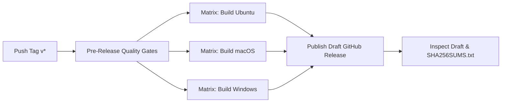

# Praxis Release Procedure & Maintainer Checklist

This document details the standardized release process for Praxis maintainers, covering versioning conventions, local validation, tag creation, automated workflow execution, artifact verification, and rollback procedures.

---

## 1. Versioning Policy

Praxis strictly adheres to [Semantic Versioning 2.0.0](https://semver.org/spec/v2.0.0.html) (`vMAJOR.MINOR.PATCH`):

- **MAJOR** (`vX.0.0`): Incompatible API changes, breaking architectural alterations, or changes to core security invariant boundaries.
- **MINOR** (`v1.X.0`): Backwards-compatible new features, new agent runtime integrations, new views, or enhanced supervisory capabilities.
- **PATCH** (`v1.0.X`): Backwards-compatible bug fixes, security patches, or documentation updates.
- **Pre-releases** (`v1.1.0-alpha.1`, `v1.1.0-rc.2`): Testing builds. The release pipeline automatically flags any tag containing a hyphen (`-`) as a GitHub Pre-release.

> **Tag Pattern Requirement:** The GitHub Actions release automation enforces the exact regex:
> `^v(0|[1-9][0-9]*)\.(0|[1-9][0-9]*)\.(0|[1-9][0-9]*)(-([0-9A-Za-z-]+(\.[0-9A-Za-z-]+)*))?(\+([0-9A-Za-z-]+(\.[0-9A-Za-z-]+)*))?$`
> Any tag that does not strictly match this pattern will fail pre-release quality gates before build jobs start.

---

## 2. Pre-Release Preparation Checklist

Before initiating a release, complete the following steps locally on a synced `main` branch:

1. **Verify Git State**:
   ```bash
   git checkout main
   git pull origin main
   git status  # Must be clean
   ```

2. **Execute Full Local Quality Gates**:
   Ensure all 50 automated test suites, typechecks, branding assertions, and production bundle builds pass:
   ```bash
   npm run check:all
   ```

3. **Update Version in `package.json`**:
   Update the version field in `package.json` without creating a git tag yet:
   ```bash
   npm version --no-git-tag-version 1.1.0
   ```

4. **Update `CHANGELOG.md`**:
   - Move all completed items from `[Unreleased]` to a new version section: `## [1.1.0] - YYYY-MM-DD`.
   - Categorize entries under `Added`, `Changed`, `Deprecated`, `Removed`, `Fixed`, or `Security`.
   - Update comparison links at the bottom of the changelog.

5. **Commit and Merge**:
   Open a pull request for the version bump and changelog update:
   ```bash
   git checkout -b chore/release-v1.1.0
   git commit -am "chore(release): prepare v1.1.0"
   git push origin chore/release-v1.1.0
   ```
   Merge the PR to `main` once all CI checks pass.

---

## 3. Triggering the Release

Once the release commit is on `main`:

### Option A: Official Release (Tag Push)
Create an annotated tag and push it to GitHub:
```bash
git checkout main
git pull origin main
git tag -a v1.1.0 -m "Release v1.1.0"
git push origin v1.1.0
```

### Option B: Dry-Run Verification (Manual Dispatch)
To test cross-platform desktop builds on hosted runners without publishing a release:
1. Navigate to **Actions** → **Release Automation** in GitHub.
2. Click **Run workflow**.
3. Select branch `main`.
4. Leave `dry_run` set to `true`.
5. Click **Run workflow**.

---

## 4. Pipeline Stages & Automation Workflow

The release workflow (`.github/workflows/release.yml`) executes three sequential phases:



1. **Pre-Release Quality Gates (`ubuntu-latest`)**:
   - Validates that the tag strictly conforms to the semantic version regex.
   - Runs `npm ci`, `check:brand`, `lint`, `typecheck`, and `npm test` (50 test suites).
   - If any check fails, packaging jobs are aborted.

2. **Package Desktop Matrix (`ubuntu-latest`, `macos-latest`, `windows-latest`)**:
   - Generates application icons (`npm run build:icons`).
   - Builds web assets and server bundles (`npm run build`).
   - Runs `electron-builder --publish never` to build native binaries:
     - **Linux**: `Praxis-1.1.0-linux-<arch>.AppImage`, `Praxis-1.1.0-linux-<arch>.deb`
     - **macOS**: `Praxis-1.1.0-mac-<arch>.dmg`, `Praxis-1.1.0-mac-<arch>.zip`
     - **Windows**: `Praxis-Setup-1.1.0.exe`, `Praxis-1.1.0-win-<arch>.zip`
   - Uploads build artifacts to workflow storage.

3. **Publish Draft Release (`ubuntu-latest`)**:
   - Downloads all platform artifacts.
   - Generates independent SHA-256 checksums (`SHA256SUMS.txt`).
   - Creates a **Draft Release** (draft: `true`, never published publicly without human review).
   - Dynamically marks pre-release status if the tag contains a hyphen.

---

## 5. Artifact Verification & Inspection

Before publishing the draft release:

1. **Open the Draft Release**: Navigate to the [GitHub Releases](https://github.com/puneetnith28/Praxis/releases) page.
2. **Verify Assets**:
   Confirm that all expected installer and portable assets are attached:
   - Linux: `.AppImage` and `.deb`
   - macOS: `.dmg` and `.zip`
   - Windows: `.exe` installer and `.zip` portable
   - `SHA256SUMS.txt`
3. **Verify Checksums Locally**:
   Download the release directory and run:
   ```bash
   sha256sum -c SHA256SUMS.txt
   ```
   Every asset must report `OK`.

---

## 6. Code Signing and Notarization Notes

- **Current Status**: Community CI builds produce **unsigned binaries**.
- **macOS Gatekeeper**: Unsigned `.dmg` files will show a warning ("Apple cannot check it for malicious software"). Users can right-click → **Open**, or run:
  ```bash
  xattr -cr /Applications/Praxis.app
  ```
- **Windows SmartScreen**: Unsigned `.exe` installers will trigger Windows Defender SmartScreen ("Windows protected your PC"). Users click **More info** → **Run anyway**.
- **Configuring Certificates**: To enable signing in production, add `APPLE_ID`, `APPLE_APP_SPECIFIC_PASSWORD`, `APPLE_TEAM_ID`, and `CSC_LINK` / `WIN_CSC_LINK` to GitHub Secrets.

---

## 7. Publishing and Post-Release Communication

1. In the GitHub Draft Release interface, verify the release notes match `CHANGELOG.md`.
2. Click **Publish release**.
3. Announce the release across community channels and project discussions.

---

## 8. Rollback and Incident Recovery

If a critical issue is discovered post-release:

- **Unpublished Draft**: Simply delete the draft release from GitHub.
- **Published Release with Critical Defect**:
  1. **Do NOT overwrite or delete git tags**: Mutating published tags breaks reproducible builds and dependency references.
  2. Edit the GitHub Release: Add a prominent warning notice at the top of the release notes. If severe, mark the release as a **Pre-release** or convert it back to a draft.
  3. Publish an immediate patch release (`vX.Y.Z+1`) containing the hotfix.
  4. Document the defect and remediation in `CHANGELOG.md`.
